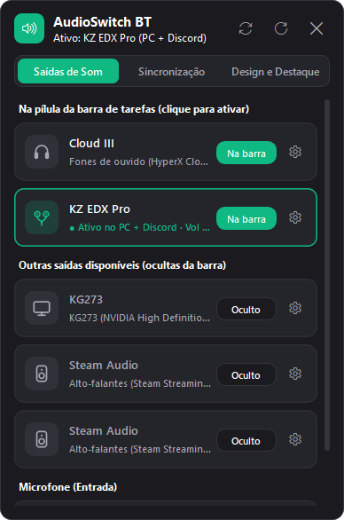
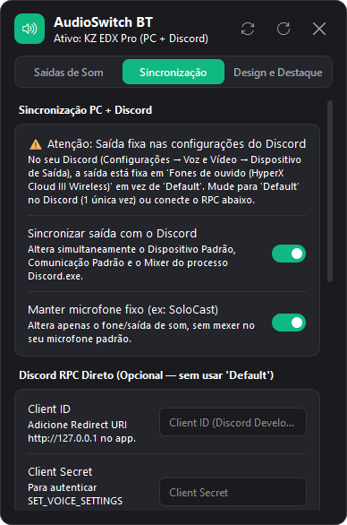
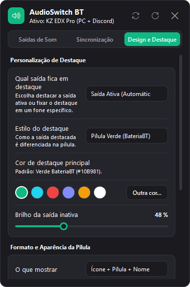

# 🎧 AudioSwitch BT — Taskbar Audio & Discord Switcher

<p align="center">
  
</p>

**AudioSwitch BT** é um widget leve e minimalista para a Barra de Tarefas do Windows 10/11 — com estética inspirada no [BateriaBT](https://github.com/EnricoSpanier/BateriaBT) — projetado para alternar instantaneamente a **saída de som do Windows e do Discord de forma sincronizada** com apenas **1 clique** (ou atalho global `Ctrl + Alt + S`), mantendo o seu **microfone fixo e intocado**.

Ideal para quem alterna entre um **headset sem fio** para uso geral/música (ex: *HyperX Cloud III Wireless*) e um **fone cabeado in-ear (IEM)** para jogos competitivos (ex: *KZ EDX Pro*) sem precisar abrir configurações do Windows ou do Discord no meio da partida.

---

## ✨ Demonstração Visual

| Aba 1: Saídas de Som & Microfone Fixo | Aba 2: Sincronização Windows + Discord | Aba 3: Design e Destaque Customizável |
| :---: | :---: | :---: |
|  |  |  |

---

## 🚀 Como Funciona

Quando você clica em um dos dispositivos na pílula da barra de tarefas (ou usa `Ctrl + Alt + S`), o **AudioSwitch BT** executa três camadas de sincronização em uma thread dedicada (MTA COM) sem travar a interface:

1. **Windows Core Audio (`IPolicyConfig`) — Triplo Papel Nativo:**
   - Altera simultaneamente:
     - **Dispositivo Padrão (`eConsole` & `eMultimedia`)**: Jogos, navegador, Spotify, sistema.
     - **Dispositivo de Comunicação Padrão (`eCommunications`)**: Voz do Discord, Teams, Steam Voice, chamadas.
2. **Roteamento Direto no Mixer de Volume do Windows (`IAudioPolicyConfigFactory`):**
   - Localiza todos os processos ativos do `Discord.exe` (incluindo o subprocesso `audio.mojom.AudioService` e renderizadores) e redireciona o fluxo de áudio diretamente para o fone selecionado em tempo real.
3. **Integração com o Discord (Modo `Default` + Discord Local RPC Opcional):**
   - Detecta automaticamente se o seu Discord está configurado como `Default` ou travado manualmente em um fone específico, exibindo um diagnóstico em tempo real na aba **Sincronização**.
   - Conta também com suporte opcional ao **Discord Local RPC** (`\\.\pipe\discord-ipc-0` via `SET_VOICE_SETTINGS`) caso você prefira que o próprio seletor interno do Discord mude sozinho.
4. **Proteção de Microfone Fixo (`eCapture`):**
   - O seu microfone dedicado (ex: *HyperX SoloCast*, *QuadCast*, *Fifine*, etc.) **nunca é alterado** quando você troca de fone. Opcionalmente, o widget pode monitorar e restaurar o microfone escolhido caso o Windows tente mudá-lo ao conectar um dongle USB.
5. **Leitura Real de Bateria via USB HID (HyperX Cloud III Wireless):**
   - Lê diretamente do dongle USB sem fio (`VID 0x03F0` / `UsagePage 0xFF13`) a porcentagem exata da bateria e o estado de carregamento com ícone de bateria + raio, sem precisar manter o HyperX NGENUITY aberto.

---

## 🛠️ Como Baixar e Instalar

### Pré-requisitos
- **Windows 10 ou Windows 11** (64-bit)
- **Python 3.10+** instalado ([baixar em python.org](https://www.python.org/downloads/))

### Passo 1: Clonar ou Baixar o Repositório
```powershell
git clone https://github.com/icexsilent/AudioSwitch.git
cd AudioSwitch
```
*(Ou clique em **Code → Download ZIP** no topo desta página e extraia em uma pasta de sua preferência).*

### Passo 2: Instalar as Dependências
Abra o terminal (PowerShell ou CMD) na pasta do projeto e execute:
```powershell
pip install -r requirements.txt
```
> As únicas dependências são `PySide6` (interface gráfica Qt6), `comtypes` (API Core Audio do Windows) e `hidapi` (leitura opcional de bateria USB HID).

### Passo 3: Iniciar o Widget
Você pode iniciar o widget de qualquer uma das formas abaixo:
- **Sem janela de console (Recomendado):** Dê dois cliques no arquivo **`Iniciar AudioSwitch.vbs`**
- **Pelo terminal:**
  ```powershell
  pythonw audio_widget.py
  ```

---

## 📦 Compilar um Executável `.exe` Portátil (Opcional)

Se quiser gerar um arquivo único **`dist\AudioSwitchBT.exe`** que roda sem precisar de terminal:

```powershell
.\build.ps1
```
O script instalará o `PyInstaller` (se necessário) e criará o executável pronto em `dist\AudioSwitchBT.exe`.

---

## 🎮 Controles na Barra de Tarefas

| Ação | Função |
| :--- | :--- |
| **Clique Esquerdo (em um fone na pílula)** | Ativa imediatamente aquele fone no Windows + Discord |
| **Clique Esquerdo (no modo compacto)** | Alterna entre o Fone A e o Fone B |
| **Clique Direito na pílula** | Abre o **Painel de Configurações** (ou menu rápido com a tecla `Shift` pressionada) |
| **Arrastar com Clique Esquerdo** | Move o widget livremente ao longo da Barra de Tarefas (a posição é salva automaticamente) |
| **Roda do Mouse (Scroll) sobre o widget** | Aumenta ou diminui o volume do fone ativo em passos de 2% |
| **Clique do Meio (Botão do Scroll)** | Abre/fecha o Painel de Configurações |
| **Atalho Global `Ctrl + Alt + S`** | Alterna entre seus 2 fones favoritos de qualquer lugar (mesmo dentro de um jogo em tela cheia) |

---

## 💬 Configurando a Sincronização com o Discord

Na aba **Sincronização** do painel (clique direito no widget), o AudioSwitch verifica automaticamente como está configurado o seu Discord:

### Opção A — Recomendada (Zero configuração extra, troca instantânea)
1. Abra o **Discord** → **Configurações de Usuário (⚙️)** → **Voz e Vídeo**.
2. Em **Dispositivo de Saída**, selecione **`Default` (Padrão)**.
3. Pronto! O Discord passará a seguir instantaneamente o dispositivo padrão/comunicação que o AudioSwitch alterna no Windows.

### Opção B — Discord Local RPC (Troca automática mesmo fora do `Default`)
Se você não quiser usar a opção `Default` no Discord:
1. Crie uma aplicação gratuita em [discord.com/developers/applications](https://discord.com/developers/applications).
2. Em **OAuth2 → Redirects**, adicione `http://127.0.0.1`.
3. Copie o **Application ID (Client ID)**, cole no campo **Discord Local RPC** dentro da aba **Sincronização** do widget e clique em **Salvar e Conectar**.
4. O Discord exibirá um prompt único de autorização; após aceitar, o widget mudará o dropdown do Discord diretamente via IPC local.

---

## 🎨 Personalização Completa (Aba *Design e Destaque*)

Você pode deixar o widget exatamente com a cara do seu setup:
- **Quem recebe a cor de destaque:**
  - *Destacar saída ativa no momento* (acompanha o fone que está tocando)
  - *Destacar ambos sempre acesos* (estilo idêntico ao BateriaBT)
  - *Fixar destaque sempre no Slot 1 ou Slot 2*
- **Modo da pílula:** Lado a lado (`[ Fone 1 | Fone 2 ]`) ou Compacto (`[ Fone Ativo ]`).
- **6 Temas de Cor:** Verde BateriaBT (`#10B981`), Azul HyperX/Cyber (`#3B82F6`), Roxo Discord (`#8B5CF6`), Vermelho HyperX (`#EF4444`), Laranja Gamer (`#F97316`) e Branco Clean (`#F4F4F6`).
- **4 Estilos Visuais:** Apenas Ponto + Ícone colorido, Fundo Suave Colorido (Glow), Borda Colorida no Item Ativo ou Barra Inferior Indicadora.
- **Renomear e Trocar Ícones:** Clique no botão `✎` ao lado de qualquer saída para escolher um apelido curto (ex: `Cloud III`, `KZ EDX Pro`) e o ícone vetorial (`Headset`, `In-Ear / IEM`, `Wireless`, `Caixa de Som`, `Monitor`).

---

## 🔄 Iniciar Junto com o Windows

- **Pelo próprio Widget:** Clique com o `Shift + Botão Direito` no widget e marque **`Iniciar com o Windows`** (cria automaticamente uma chave em `HKCU\Software\Microsoft\Windows\CurrentVersion\Run`).
- **Ou via Pasta Inicializar (`shell:startup`):** Crie um atalho para o arquivo `Iniciar AudioSwitch.vbs` (ou para `dist\AudioSwitchBT.exe`) dentro de `%APPDATA%\Microsoft\Windows\Start Menu\Programs\Startup`.

---

## 🗂️ Estrutura do Projeto

- `audio_widget.py` — Interface gráfica PySide6 (pílula acoplada ao `Shell_TrayWnd`, animações, atalho global `RegisterHotKey` e painel de 3 abas).
- `audio_backend.py` — Backend Core Audio (`IMMDeviceEnumerator`, `IAudioEndpointVolume`, `IPolicyConfig`, `IAudioPolicyConfigFactory`), trabalhador COM MTA dedicado, leitor de bateria USB HID HyperX e cliente Discord Local RPC (`discord-ipc-0`).
- `graphics.py` — Renderizador vetorial 24×24 (`QPainter`) para ícones de headsets, IEMs, caixas de som, bateria e indicadores.
- `Iniciar AudioSwitch.vbs` / `Iniciar AudioSwitch.bat` — Inicializadores silenciosos para Windows.
- `build.ps1` — Script automatizado para empacotar em `.exe` via PyInstaller.

---

## 🙏 Créditos e Inspiração

- Visual e arquitetura de acoplamento na barra de tarefas inspirados no excelente projeto [**BateriaBT**](https://github.com/EnricoSpanier/BateriaBT) de [@EnricoSpanier](https://github.com/EnricoSpanier).

## 📄 Licença

Distribuído sob a licença [MIT](LICENSE).
